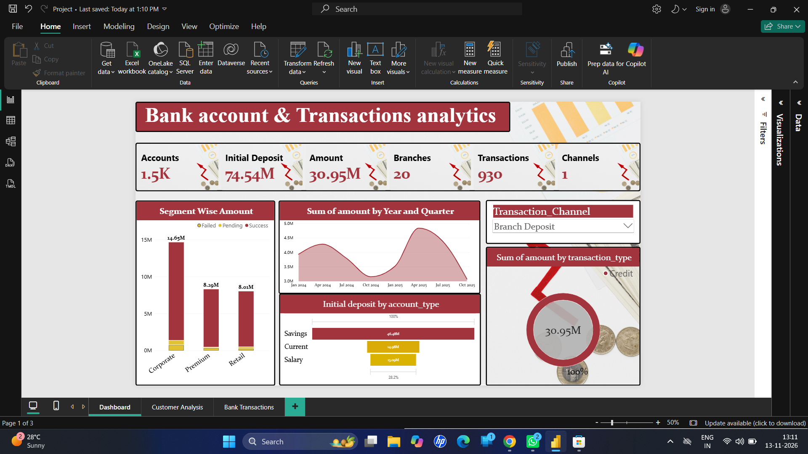
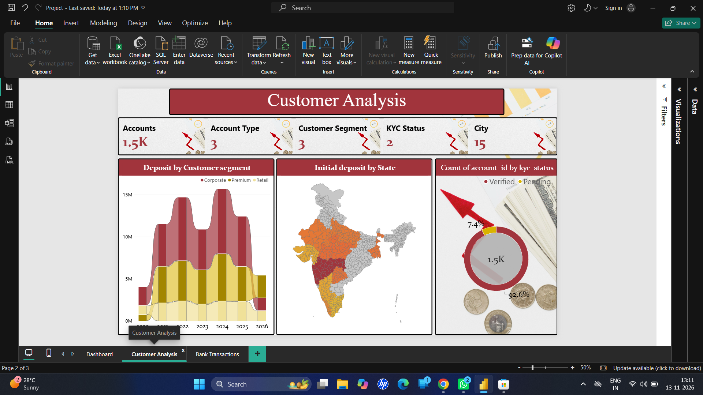
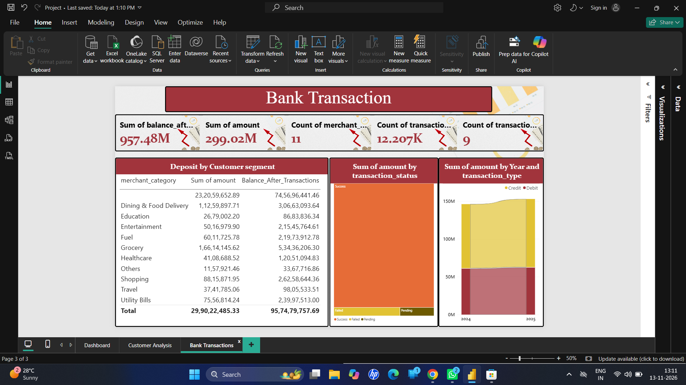

# Bank Transactions Analysis | MySQL & Power BI

## Project Overview
This project focuses on analyzing banking customers, account information, and transaction data using MySQL and Power BI.

The objective is to understand customer behavior, identify transaction trends, analyze banking operations, and generate meaningful business insights to support better decision-making.

## Tools & Technologies
- **MySQL:** Data cleaning, exploratory data analysis (EDA), SQL queries, joins, subqueries, aggregations, CASE statements and views.
- **Power BI:** Dashboard development and data visualization.
- **Microsoft Excel / CSV:** Dataset storage and handling.

## Dataset Description

The project uses two datasets:

**1. Account Holders**
- Account ID
- Customer Name
- Gender
- Date of Birth
- City and State
- Account Type
- Customer Segment
- Branch Name
- Account Opening Date
- Initial Deposit
- KYC Status

**2. Bank Transactions**
- Transaction ID
- Account ID
- Transaction Date
- Transaction Type
- Transaction Channel
- Transaction Amount
- Merchant Category
- Transaction Status
- Balance After Transaction

## SQL Analysis

The project includes the following analysis:

### 1. Customer Analysis
- Account distribution by account type.
- Customer segmentation analysis.
- Average initial deposit by customer segment.
- Account opening trends.
- KYC status analysis.
- Customer age group analysis.

### 2. Transaction Analysis
- Total credit vs debit transactions.
- Monthly transaction trends.
- Most frequently used transaction channels.
- Customer spending by merchant category.
- Branch-wise transaction analysis.

### 3. Customer-Level Insights
- Top 10 customers by transaction value.
- Average closing balance by customer segment.
- Identification of dormant accounts.
- Identification of customers with pending KYC who are transacting.

### 4. Risk & Operational Analysis
- Transaction failure rate by channel.
- Identification of high-value transactions.
- Transaction amount categorization.
- Creation of reusable SQL views.

## Power BI Dashboard

An interactive Power BI dashboard was developed to present banking transaction insights and customer information visually.

### Dashboard Screenshots

**Dashboard Overview**



**Customer Insights**



**Transaction Analysis**



## Project Structure

```text
Bank-Transactions-Analysis/
│
├── Data/
│   ├── account_holders.csv
│   └── bank_transactions.csv
│
├── MySQL/
│   ├── 01_database_and_tables.sql
│   ├── 02_exploratory_data_analysis.sql
│   └── 03_business_insights_queries.sql
│
├── ScreenShots/
│   ├── Customer_Insights.png
│   ├── Dashboard_Overview.png
│   └── Transaction_Analysis.png
│
├── Bank_Transactions_Dashboard.pbix
├── Bank_Transactions_Reports.pdf
├── Problem_Statement.pdf
└── README.md
```

## How to Run This Project

1. Download or clone this repository.
2. Open MySQL Workbench.
3. Execute `01_database_and_tables.sql` to create the database and tables.
4. Import the two CSV datasets into their respective tables.
5. Execute `02_exploratory_data_analysis.sql` for exploratory analysis.
6. Execute `03_business_insights_queries.sql` to explore business questions and insights.
7. Open the Power BI dashboard file to explore the visualizations.

**Note:** The database creation script drops an existing database named `bank_transactions_db` before recreating it. Back up any existing database with that name before running the script.

## Key Learnings

- Practical experience with SQL and relational databases.
- Understanding of customer and transaction data.
- Performing exploratory data analysis.
- Writing business-oriented SQL queries.
- Identifying transaction patterns and operational risks.
- Developing interactive dashboards using Power BI.

## Author

**Shivprasad Chandrapad**

Aspiring Data Analyst | SQL | MySQL | Power BI | Python | Excel
